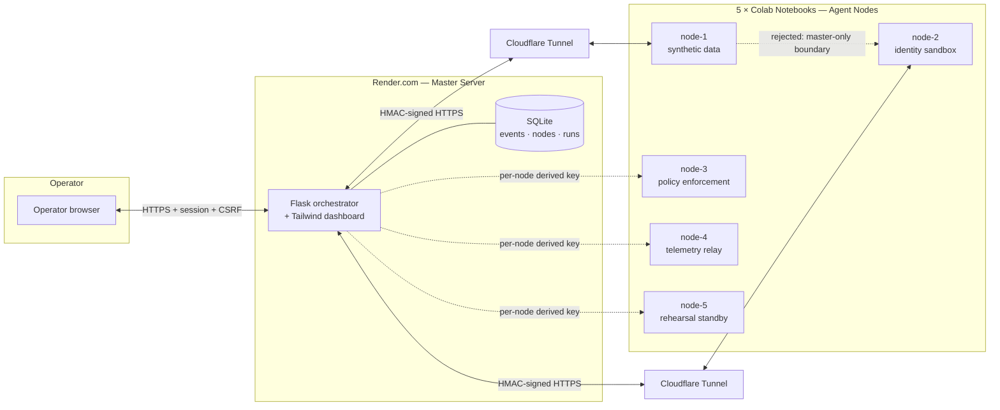

<div align="center">


### Privacy-preserving detection of cloud data breaches, identity attacks, and virtualization threats

A live, distributed security console that stages three classes of attack against **synthetic, self-owned targets** and proves — with real cryptography, not canned animations — that each one is detected and blocked in real time.

[](https://www.python.org/)
[](https://flask.palletsprojects.com/)
[](https://tailwindcss.com/)
[](https://render.com/)
[](https://developers.cloudflare.com/cloudflare-one/connections/connect-networks/)
[](#license)

[Live demo](#-running-the-demo) · [Architecture](#-architecture) · [Scenarios](#-the-three-scenarios) · [Security model](#-security-model) · [Setup](#-setup)

</div>

<br>

<div align="center">
  
</div>

<br>

## Overview

Aegis is a small distributed system built to answer one question honestly: **can a lightweight set of real controls actually detect and stop a staged attack, live, in front of an audience?**

Five independent agent nodes (standing in for cloud VMs) register with a central orchestrator over signed, authenticated HTTP. An operator triggers one of three staged attack patterns from the dashboard; the target node's own policy engine evaluates the pattern against a real threshold, and the dashboard streams the resulting **detected → analyzing → prevented** sequence as it happens — sourced from signed telemetry the agents themselves emit, not scripted UI states.

> **Everything is synthetic.** Fixed dummy datasets, a sandboxed demo-only auth endpoint, and fixed logical ports stand in for real infrastructure. No exploit payloads, no production targets, no real credentials. See [Security model](#-security-model).

<br>

## 🖼️ Screenshots

<table>
<tr>
<td width="60%"></td>
<td width="40%"></td>
</tr>
<tr>
<td align="center"><sub>Security overview — live node status, stat summary, event log</sub></td>
<td align="center"><sub>Operator access — password-gated, rate-limited login</sub></td>
</tr>
</table>

<details>
<summary><b>Mobile layout</b></summary>
<br>

</details>

<br>

## 🏗️ Architecture



Each agent node is reachable only through its own **Cloudflare Tunnel** URL and authenticates every request with an **HMAC signature derived from a per-node key** — the master's root secret never leaves the master server, and no two nodes share a key. See [`SETUP.md`](SETUP.md) for the full Cloudflare Tunnel / Render / Colab walkthrough.

<br>

## 🎯 The three scenarios

| # | Scenario | Staged pattern | Real control | Outcome |
|---|---|---|---|---|
| 1 | **Cloud data breach** | Rapid bulk reads against a synthetic customer-records endpoint | Sliding-window volume guard (80 rows / 10s) | Actor blocked, requests rejected `403` |
| 2 | **Identity attack** | Repeated failed logins, then a replayed one-time token | Rate limit + lockout, single-use token registry | Account locked `429`, replayed token rejected `403` |
| 3 | **Virtualization threat** | Node-to-node request toward a peer's internal-only service | Application-level segmentation (master-only HMAC boundary) | Peer request rejected `401`, zero internal services reached |

Every run moves through the same observable lifecycle, driven entirely by signed events from the node that handled the request:

```
Detected  →  Analyzing  →  Prevented
  🟠            🟡             🟢
```

<br>

## 🔐 Security model

Aegis treats the *defense* layer as the actual product — the "attack" side is theatrical, the control side is not.

| Control | Implementation |
|---|---|
| **Transport authentication** | HMAC-SHA256 over `sender + method + path + timestamp + nonce + body hash`, verified on every master ↔ agent request |
| **Replay protection** | 60s timestamp window + single-use nonce tracking per sender |
| **Per-node credentials** | Each node's key is derived from the master secret (`tools_node_key.py`) — the root secret is never placed on a Colab notebook |
| **Operator auth** | Password-gated session, rate-limited login (10 attempts / min / IP), HttpOnly + SameSite cookies |
| **CSRF protection** | Per-session token required on every state-changing request |
| **Response hardening** | Strict CSP, `X-Content-Type-Options`, `Referrer-Policy`, `Cache-Control: no-store` |
| **Synthetic-only surfaces** | Fixed dummy dataset, fixed sandbox account, fixed logical port — no path to real data or real systems |

<br>

## 📁 Repository structure

```
cloud-security-demo/
├── master-server/        # Flask orchestrator + Tailwind dashboard (deploys to Render)
│   ├── app.py
│   ├── events/            # event schema + SQLite-backed store
│   ├── templates/
│   └── static/
├── node-agent/            # Agent run inside each Colab notebook
│   └── agent.py
├── scenarios/              # The three staged attack scripts
│   ├── data_breach.py
│   ├── identity_attack.py
│   └── virtualization_threat.py
├── common/                 # Shared event contract + HMAC security module
├── colab/                  # Node bootstrap notebook
├── run_local.py            # Launch master + all 5 agents locally in one command
├── run_scenario.py         # CLI to trigger a scenario without the browser
└── SETUP.md / RUN_OF_SHOW.md / ARCHITECTURE.md
```

<br>

## 🚀 Setup

<details>
<summary><b>Run everything locally (one command)</b></summary>

```bash
pip install -r requirements.txt
python run_local.py
```

This launches the master server and all 5 agent nodes as local processes with ephemeral, auto-generated secrets, and prints the dashboard URL and operator password to the console.

</details>

<details>
<summary><b>Live demo: Colab nodes + Render master</b></summary>

1. Deploy `master-server/` to Render (`render.yaml` included — generates `MASTER_SECRET`/`SESSION_SECRET` automatically; set `ADMIN_PASSWORD` yourself).
2. Generate a per-node key for each of `node-1`…`node-5`:
   ```bash
   python tools_node_key.py node-1
   ```
3. Open `colab/node_template.ipynb` in Colab — one copy per node. Set `NODE_NAME`, paste the generated key, point `MASTER_URL` at your Render URL.
4. Each notebook opens its own Cloudflare Tunnel and registers with the master automatically.

Full walkthrough: [`SETUP.md`](SETUP.md). Suggested live-demo timing: [`RUN_OF_SHOW.md`](RUN_OF_SHOW.md).

</details>

<details>
<summary><b>Trigger a scenario without the dashboard</b></summary>

```bash
python run_scenario.py data_breach --node node-1 --master https://your-service.onrender.com
```

</details>

<br>

## 🧰 Stack

<div align="center">


</div>

<br>

## ⚠️ Scope & disclaimer

This is a **demonstration prototype**, not a production security product. All attacks are staged sequences run against fixed, self-owned synthetic targets created specifically to receive them — no functional exploit code, no real credential harvesting, no real privilege escalation. The detection and prevention logic is real and genuinely enforced; the "attacker" side exists purely to trigger it in a way an audience can follow live.

<br>

## License

[MIT](LICENSE) — replace with your preferred license before publishing.

<div align="center">
<sub>Built with Aegis · Evidence comes from the agents, not the interface.</sub>
</div>
